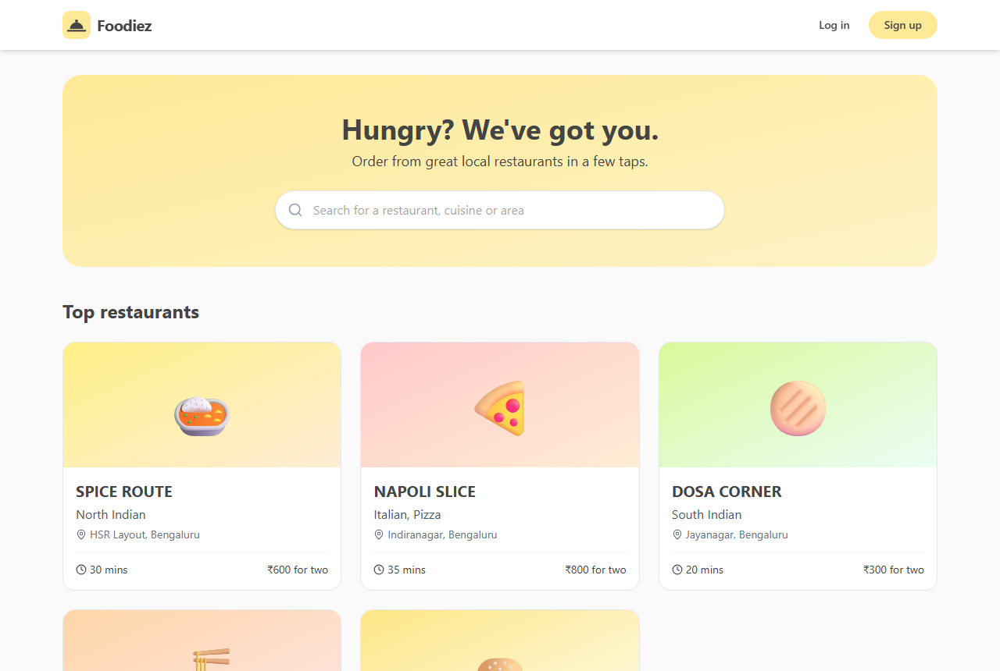
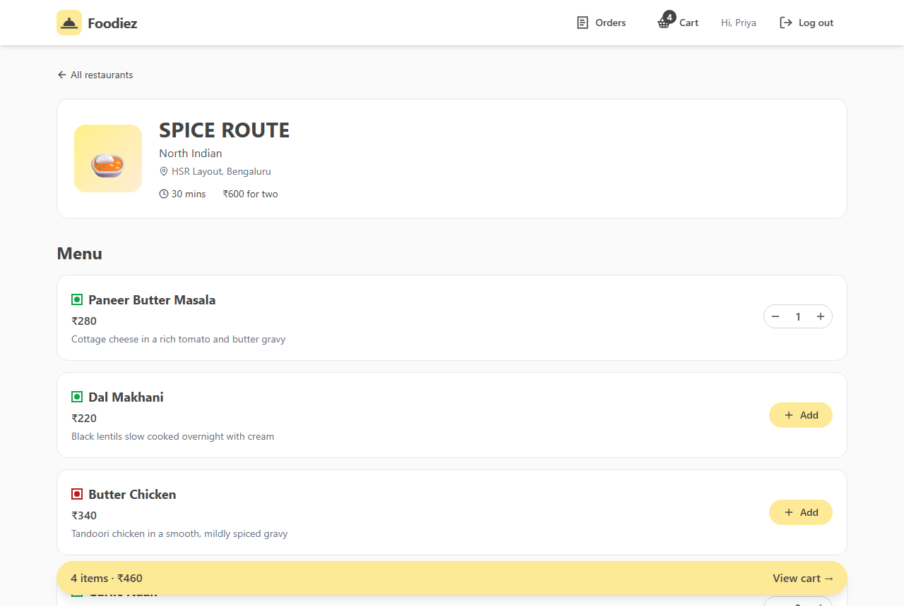
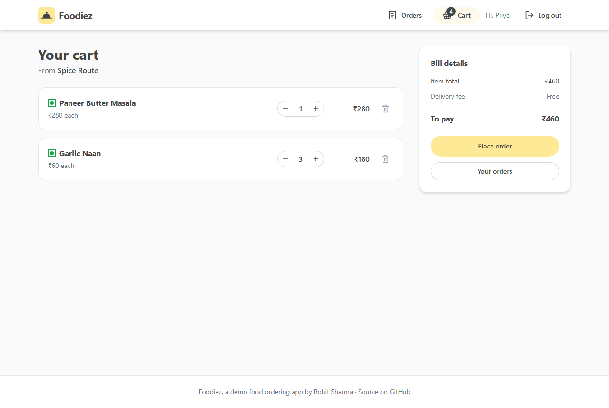
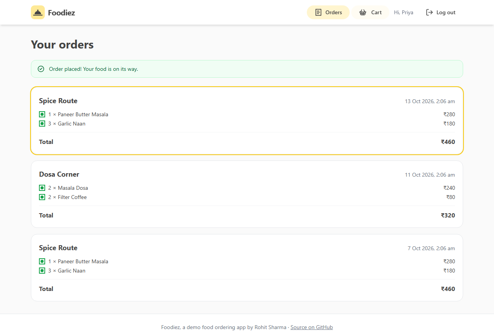
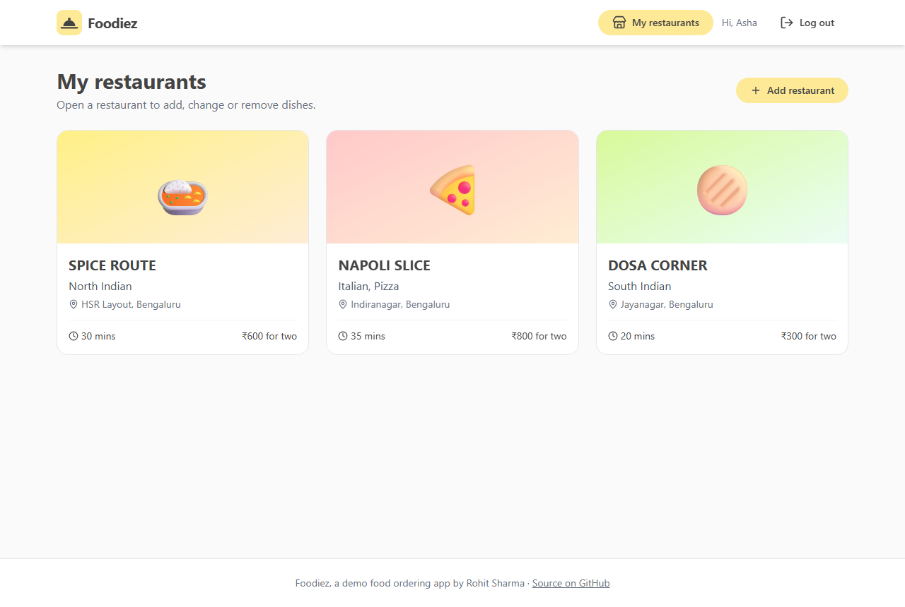
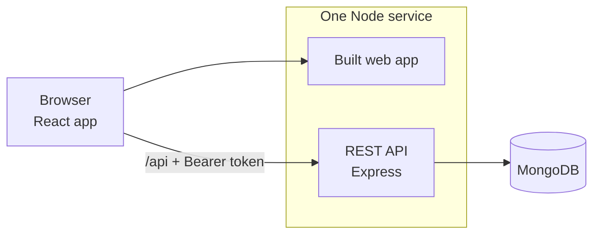

# Foodiez

[](https://github.com/iamrs77/foodiez/actions/workflows/ci.yml)

A food ordering web app. Customers browse restaurants, add dishes to a cart and place orders. Restaurant owners (vendors) add their restaurants and manage their menus.



## About

Foodiez is a full-stack JavaScript app: a React web app and an Express API on MongoDB.

- **Browse and search** restaurants by name, cuisine or area, without logging in.
- **Order** from one restaurant at a time, like real delivery apps: add dishes, change quantities, and see your order history with the prices you actually paid.
- **Run restaurants** as a vendor: add restaurants, and add, change or delete dishes, marked veg or non-veg. Vendors can only change their own.
- **Try the demo** without signing up: every visitor gets a private copy of the restaurants, menus and past orders for 24 hours, and can switch between the customer and the restaurant owner.

| Menu                                    | Cart                                    |
| --------------------------------------- | --------------------------------------- |
|  |  |

| Order history                                 | Vendor's restaurants                                             |
| --------------------------------------------- | ---------------------------------------------------------------- |
|  |  |

## How it works



- **The API enforces every rule.** Two roles, customer and vendor, with no admin to escalate to. Vendors can only change their own restaurants, customers only their own cart and orders, and every request body goes through a zod schema that drops unknown fields. The web app only hides what the API would refuse anyway.
- **Orders are snapshots.** An order keeps a copy of each dish and its price, worked out by the API, so changing a menu later never changes order history.
- **Each demo visitor gets a private sandbox.** Every document has a `sandbox` field, the API scopes every query to the visitor's sandbox, and a MongoDB TTL index deletes the whole demo after 24 hours, with no clean-up job.
- **Free to host.** On the public site the API also serves the built web app, so it's one free Render service with a free MongoDB Atlas cluster.
- **Tested end to end.** 53 API tests run real HTTP requests against a real in-memory MongoDB, and 30 web app tests click through the whole app.

The design, with diagrams, the data model, failure modes and the reasons behind each decision, is in the [documentation](#documentation).

## Tech stack

| Part     | Tools                                                                   | Why |
| -------- | ----------------------------------------------------------------------- | --- |
| Web app  | React 19, Vite, React Router, Redux Toolkit (RTK Query), Tailwind CSS 4 | The 2021 app's React, Redux and Tailwind, brought up to date. RTK Query caches server data and refreshes it by tag. |
| API      | Node.js, Express 5, Mongoose, zod, JWT, bcrypt, helmet                  | Express 5 sends async errors to one handler, and zod checks every request body. |
| Database | MongoDB                                                                 | Menus and orders are read whole, it runs in memory for development and tests, and TTL indexes clean up demos. |
| Tests    | Vitest, Testing Library, supertest, mongodb-memory-server               | Real HTTP requests against a real database, with no setup. |
| DevOps   | Docker Compose, nginx, GitHub Actions, Render, MongoDB Atlas            | CI checks everything on each push, and the demo runs on free plans. |

What each choice replaced or was up against: [ADR 0008](docs/adr/0008-tech-stack.md).

## Run it locally

You need **[Node.js](https://nodejs.org) 22 or newer** (check with `node -v`) and **Git**. You don't need to install MongoDB or Docker.

```bash
git clone https://github.com/iamrs77/foodiez.git
cd foodiez
npm install
npm run dev
```

When the terminal shows `Local: http://localhost:5173/`, open that address and log in with one of the demo accounts below, or press **Try the demo**. (If port 5173 is busy, the web app picks the next free port and shows that one instead.)

- `npm install` installs everything for the API and the web app.
- `npm run dev` starts the API with its own temporary MongoDB and demo data, then starts the web app.
- The first start downloads MongoDB (about 75 MB, once), so it can take a minute or two.
- Press `Ctrl+C` to stop. The data is reset every time you start again.

### Demo accounts

Every demo account uses the password `password123`. The login page has buttons that fill them in for you.

| Account                | What you can do                                                         |
| ---------------------- | ----------------------------------------------------------------------- |
| `customer@foodiez.dev` | Order food. Already has two past orders.                                |
| `vendor@foodiez.dev`   | Owns Spice Route, Napoli Slice and Dosa Corner. Can change their menus. |
| `vendor2@foodiez.dev`  | Owns Wok Express and Burger Barn.                                       |

You can also create your own customer or vendor account on the sign-up page. On the public site, these shared accounts and sign-ups are turned off, and visitors use **Try the demo** instead.

### With Docker

If you have [Docker](https://docs.docker.com/get-docker/), this runs MongoDB, the API, and nginx serving the web app, like a production setup with a separate web server.

```bash
docker compose up --build
```

Open **http://localhost:8080**. The demo data is added the first time the database starts, and your data stays between restarts. Press `Ctrl+C` to stop. Run `docker compose down` to remove the containers, and add `--volumes` to delete the data too.

If you put this online, set your own secret first, for example `JWT_SECRET=some-long-random-text docker compose up --build`.

### With your own MongoDB

Use this when you work on the API and want to keep your data. Start MongoDB with `docker compose up -d db`, install it yourself, or use a free [MongoDB Atlas](https://www.mongodb.com/atlas) database. Then:

```bash
cd backend
cp .env.example .env    # Windows PowerShell: copy .env.example .env
npm run dev             # the API, restarts when you change code
```

Change `MONGODB_URI` in `backend/.env` if your database isn't at `mongodb://localhost:27017`. In a second terminal, start the web app with `cd frontend` and `npm run dev`. To reset the database to the demo data, run `npm run seed` in `backend`.

### Deploy it for free

The public demo runs on a free Render web service and a free MongoDB Atlas cluster. [docs/deploy.md](docs/deploy.md) has the steps, and `render.yaml` has the settings.

### Settings

The API reads these from `backend/.env` or from environment variables. The quick start and Docker set them for you.

| Name                  | What it is                                                         | Default                 |
| --------------------- | ------------------------------------------------------------------ | ----------------------- |
| `MONGODB_URI`         | Where MongoDB is (required)                                        |                         |
| `JWT_SECRET`          | Secret for signing login tokens, at least 16 characters (required) |                         |
| `JWT_EXPIRES_IN`      | How long a login lasts                                             | `1d`                    |
| `PORT`                | Port for the API                                                   | `4000`                  |
| `CORS_ORIGIN`         | Web app addresses allowed to call the API, comma separated         | `http://localhost:5173` |
| `TRUST_PROXY`         | Number of proxies in front of the API (`1` behind nginx)           | `0`                     |
| `SEED_DEMO_DATA`      | Add the demo data when the database is empty                       | `false`                 |
| `DEMO_ACCOUNTS_LOGIN` | Let people log in to the demo accounts with the shared password    | `true`                  |
| `SIGNUPS_ENABLED`     | Let visitors create their own accounts                             | `true`                  |
| `DEMO_ENABLED`        | Offer **Try the demo**                                             | `true`                  |
| `DEMO_TTL_HOURS`      | How long a visitor's demo lasts                                    | `24`                    |
| `DEMO_MAX_ACTIVE`     | Most demos at once                                                 | `200`                   |
| `DEMO_RATE_LIMIT`     | New demos per IP address per hour                                  | `10`                    |
| `WEB_APP_DIR`         | Folder of the built web app; when set, the API serves it too       | not set                 |

If a required setting is missing, the API stops at startup and says which one.

### Troubleshooting

| What you see                                                | What to do                                                                                                                                                      |
| ----------------------------------------------------------- | --------------------------------------------------------------------------------------------------------------------------------------------------------------- |
| `npm install` fails with `Unsupported engine`               | Your Node.js is too old. Install version 22 or newer from [nodejs.org](https://nodejs.org).                                                                     |
| `Port 4000 is already in use`                               | Another program (often an earlier run that didn't stop) uses port 4000. Close it and run `npm run dev` again.                                                   |
| The first `npm run dev` stops while downloading MongoDB     | Check your internet connection and try again. Behind a strict company network, use [Docker](#with-docker) or [your own MongoDB](#with-your-own-mongodb) instead. |
| The page says "Can't reach the server. Is the API running?" | The API isn't running or has stopped. Look at the `[api]` lines in the terminal for the reason.                                                                 |
| You want to start from the demo data again                  | With the quick start, stop and run `npm run dev` again. With your own MongoDB, run `npm run seed` in `backend`.                                                 |

## Tests

```bash
npm test    # from the project root: API tests, then web app tests
```

You can also run `npm test` inside `backend` or `frontend` on its own. The API tests start their own in-memory MongoDB, so they need no setup either.

- **API tests** send real HTTP requests to the app. They check, for example, that a vendor can't change another vendor's restaurant, that one customer can't touch another customer's cart, that nobody can sign up as an admin, that old orders keep the price that was paid, and that two demo visitors never see each other's changes.
- **Web app tests** render the real pages with a fake network. They cover logging in, coming back to the page that asked for a login, adding dishes, the one-restaurant cart rule, placing an order, starting and switching demos, and the error messages.

GitHub Actions runs both on every push, along with lint, format checks and the build, and also checks that the Docker setup starts.

## API

| Method | Path                          | Who       | What it does                                                                  |
| ------ | ----------------------------- | --------- | ----------------------------------------------------------------------------- |
| POST   | `/api/auth/register`          | anyone    | Create an account                                                             |
| POST   | `/api/auth/login`             | anyone    | Log in, returns a token                                                       |
| GET    | `/api/auth/me`                | logged in | Your account                                                                  |
| GET    | `/api/restaurants?search=`    | anyone    | List or search restaurants                                                    |
| GET    | `/api/restaurants/:id`        | anyone    | One restaurant                                                                |
| GET    | `/api/restaurants/:id/dishes` | anyone    | A restaurant's menu                                                           |
| GET    | `/api/restaurants/mine`       | vendor    | Your restaurants                                                              |
| POST   | `/api/restaurants`            | vendor    | Add a restaurant                                                              |
| PATCH  | `/api/restaurants/:id`        | owner     | Change a restaurant                                                           |
| DELETE | `/api/restaurants/:id`        | owner     | Delete a restaurant and its menu                                              |
| POST   | `/api/restaurants/:id/dishes` | owner     | Add a dish                                                                    |
| PATCH  | `/api/dishes/:id`             | owner     | Change a dish                                                                 |
| DELETE | `/api/dishes/:id`             | owner     | Delete a dish                                                                 |
| GET    | `/api/cart`                   | customer  | Your cart with the total                                                      |
| POST   | `/api/cart/items`             | customer  | Add a dish (or raise its quantity)                                            |
| PATCH  | `/api/cart/items/:id`         | customer  | Change a quantity                                                             |
| DELETE | `/api/cart/items/:id`         | customer  | Remove a dish                                                                 |
| DELETE | `/api/cart`                   | customer  | Empty the cart                                                                |
| POST   | `/api/orders`                 | customer  | Order everything in the cart                                                  |
| GET    | `/api/orders`                 | customer  | Your orders, newest first                                                     |
| GET    | `/api/config`                 | anyone    | What this site offers (sign-ups, the demo)                                    |
| POST   | `/api/demo`                   | anyone    | Start a private demo as `{ "as": "customer" }` or `"vendor"`, returns a token |
| POST   | `/api/demo/switch`            | demo      | Log in as the other side of the same demo                                     |
| GET    | `/api/health`                 | anyone    | Whether the API and database are up                                           |

The API runs on http://localhost:4000. Send the token as `Authorization: Bearer <token>`. Errors look like `{ "message": "...", "errors": [{ "field": "...", "message": "..." }] }`.

## Project structure

The API and the web app live side by side, each with its own `package.json`. The root `package.json` runs commands in both ([ADR 0001](docs/adr/0001-one-repository.md)).

```
package.json              npm install / dev / test / build / start for the whole project
backend/                  The REST API
  src/
    server.js             Connects to MongoDB, adds the demo data if empty, starts the API
    app.js                Middleware and routes, and serving the built web app when WEB_APP_DIR is set
    config.js             Reads and checks the settings (environment variables)
    routes/               URLs, with the login and role each one needs
    controllers/          What each endpoint does: auth, restaurants, dishes, cart, orders, demo
    middleware/           Login (requireAuth, optionalAuth, requireRole), validation, errors
    models/               Mongoose schemas, and the sandbox fields every collection shares
    seed/                 Demo data, loaded as the showcase or as a visitor's sandbox
  scripts/dev-memory.js   Runs the API with a temporary in-memory MongoDB
  test/                   API tests, against an in-memory MongoDB
frontend/                 The React web app
  src/
    app/                  Redux store and every API call (RTK Query)
    features/auth/        The logged-in user, kept across reloads
    pages/                One file per page; vendor pages in pages/vendor
    components/           Navbar, cards, form fields, the demo card and banner
    lib/                  Formatting, error messages, site settings, small hooks
  nginx.conf              Serves the app and passes /api to the API in Docker
docs/
  architecture.md         How it works: diagrams, data model, flows, security, failure modes
  deploy.md               Deploying for free on Render and MongoDB Atlas
  adr/                    Decision records: why each big choice was made, and what it costs
docker-compose.yml        MongoDB + API + web app with nginx
render.yaml               The free deployment on Render
```

## Documentation

- [Architecture](docs/architecture.md): the system, the data model, the main flows, security, failure modes and limits
- [Deployment](docs/deploy.md): deploying for free on Render and MongoDB Atlas
- Decision records:
  1. [One repository for the API and the web app](docs/adr/0001-one-repository.md)
  2. [Keep MongoDB, with Mongoose](docs/adr/0002-mongodb.md)
  3. [Logins with signed tokens (JWT)](docs/adr/0003-jwt-logins.md)
  4. [Two roles, ownership checked on every change, and no admin](docs/adr/0004-roles-and-ownership.md)
  5. [One restaurant per cart, and orders that keep a copy of what was ordered](docs/adr/0005-cart-and-orders.md)
  6. [A private sandbox per demo visitor, deleted by TTL indexes](docs/adr/0006-demo-sandboxes.md)
  7. [One free service on Render, with MongoDB Atlas](docs/adr/0007-one-free-service.md)
  8. [The tech stack, and what each choice replaced](docs/adr/0008-tech-stack.md)

## History

I first built Foodiez in 2021 as five separate repos: an Express API, and the same React app four times (plain CSS, Material-UI, Tailwind and AWS Amplify). In 2026 I merged the API and the Tailwind app into this repo and rebuilt them. The rebuild fixed security problems (anyone could sign up as an admin, and any vendor could edit any restaurant), replaced the crash-prone request handling, added a real order model, tests, Docker and CI, and moved the web app from Create React App to Vite. Later that year it got private demo sandboxes and free hosting. The original 2021 commits are still in the history.

## Ideas for later

- Place orders atomically, with an idempotency key, so two tabs can't place the same cart twice (see the [failure modes](docs/architecture.md#failure-modes))
- Online payments
- A page where vendors see incoming orders
- Photo uploads for restaurants and dishes
- Ratings and reviews
- Pages (pagination) and a search index for long restaurant lists
