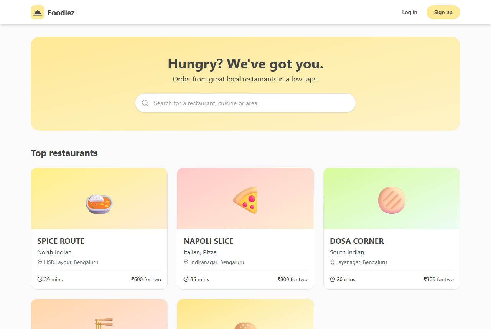
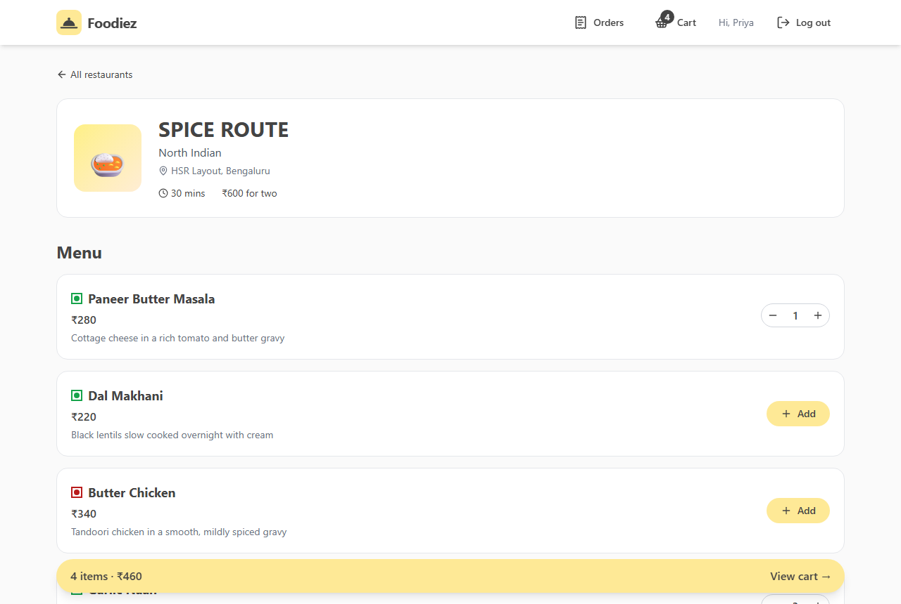
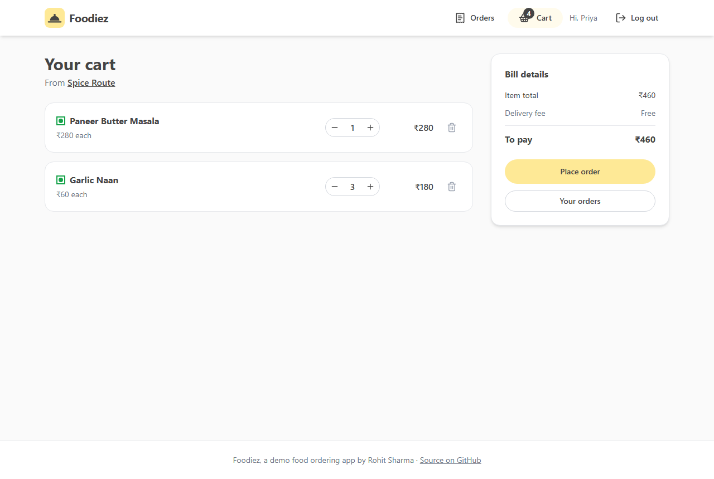
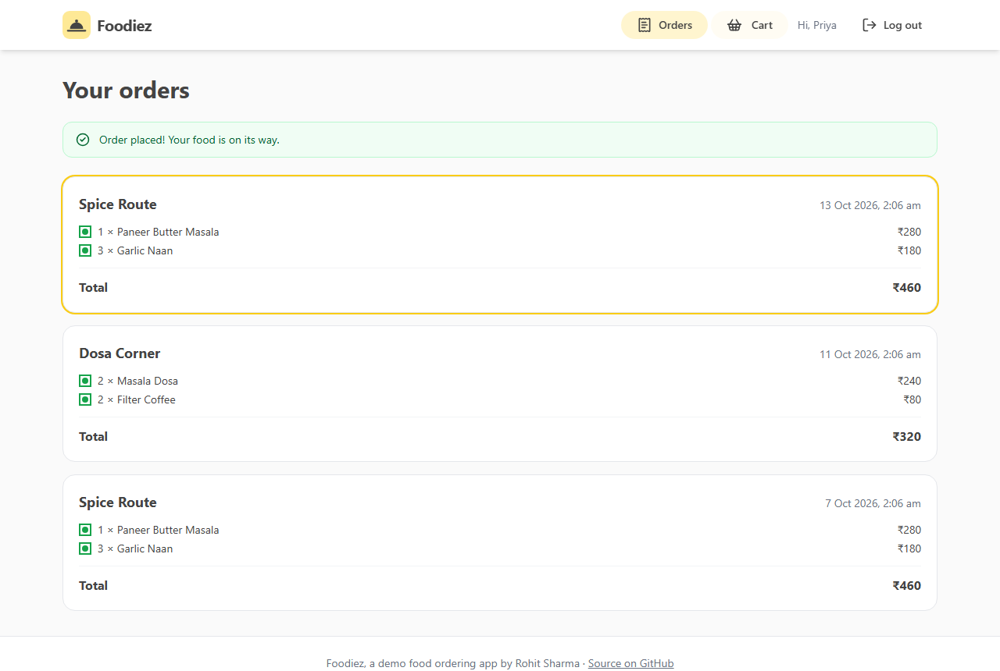
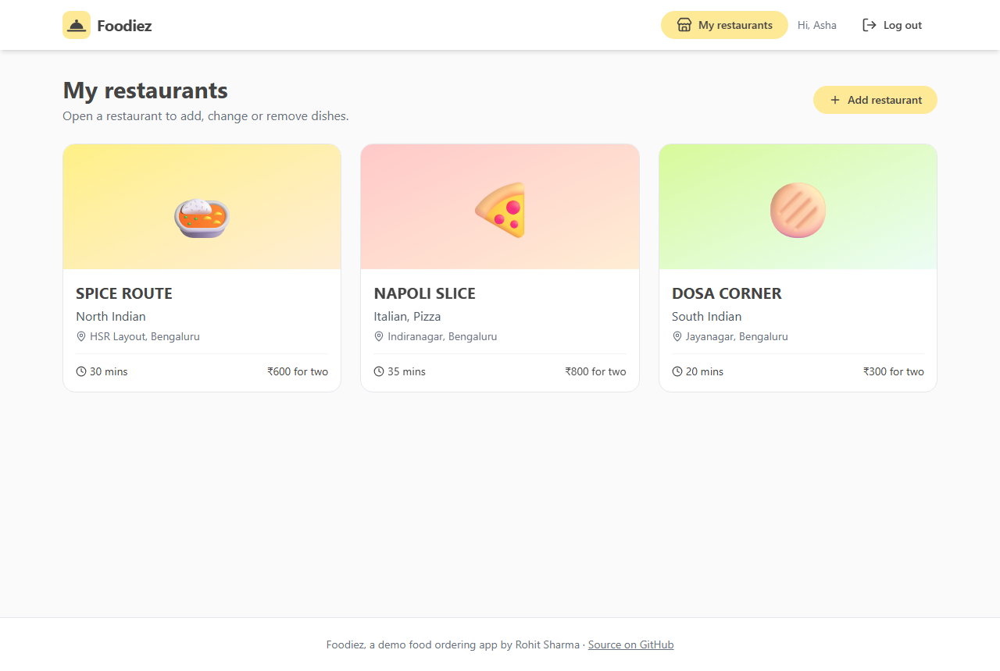

# Foodiez

[](https://github.com/iamrs77/foodiez/actions/workflows/ci.yml)

A food ordering web app. Customers browse restaurants, add dishes to a cart and place orders. Restaurant owners (vendors) add their restaurants and manage their menus.

Built with **React**, **Node.js (Express)** and **MongoDB**.



## Quick start

You need **[Node.js](https://nodejs.org) 22 or newer** (check with `node -v`) and **Git**. You don't need to install MongoDB or Docker.

```bash
git clone https://github.com/iamrs77/foodiez.git
cd foodiez
npm install
npm run dev
```

When the terminal shows `Local: http://localhost:5173/`, open that address and log in with one of the demo accounts below. (If port 5173 is busy, the web app picks the next free port and shows that one instead.)

- `npm install` installs everything for the API and the web app.
- `npm run dev` starts the API with its own temporary MongoDB and demo data, then starts the web app.
- The first start downloads MongoDB (about 75 MB, once), so it can take a minute or two.
- Press `Ctrl+C` to stop. The data is reset every time you start again.

## Demo accounts

Every demo account uses the password `password123`. The login page has buttons that fill them in for you.

| Account                | What you can do                                                         |
| ---------------------- | ----------------------------------------------------------------------- |
| `customer@foodiez.dev` | Order food. Already has two past orders.                                |
| `vendor@foodiez.dev`   | Owns Spice Route, Napoli Slice and Dosa Corner. Can change their menus. |
| `vendor2@foodiez.dev`  | Owns Wok Express and Burger Barn.                                       |

You can also create your own customer or vendor account on the sign-up page.

## What it does

**For customers**

- Browse and search restaurants by name, cuisine or area, without logging in.
- Add dishes to the cart and change quantities. Like real delivery apps, one order comes from one restaurant.
- Place an order and see your order history, with the price you actually paid.

**For vendors**

- Add restaurants, and add, change or delete dishes (marked veg or non-veg).
- Vendors can only change their own restaurants. The API checks this on every request, not just the web app.

**Under the hood**

- Passwords are hashed with bcrypt. Logging in gives a JWT token.
- Login attempts are rate limited, and a wrong email and a wrong password give the same error, so nobody can find out who has an account.
- Every request body is checked with zod. Bad data gets a clear `400` error that the web app shows next to the right field.
- Orders keep a copy of each dish and its price, so changing a menu later doesn't change old orders.
- 38 API tests and 22 web app tests. GitHub Actions runs them on every push and also checks that the Docker setup starts.

| Menu                                    | Cart                                    |
| --------------------------------------- | --------------------------------------- |
|  |  |

| Order history                                 | Vendor's restaurants                                             |
| --------------------------------------------- | ---------------------------------------------------------------- |
|  |  |

## Tech stack

| Part     | Tools                                                                   |
| -------- | ----------------------------------------------------------------------- |
| Web app  | React 19, Vite, React Router, Redux Toolkit (RTK Query), Tailwind CSS 4 |
| API      | Node.js, Express 5, Mongoose, zod, JWT, bcrypt, helmet                  |
| Database | MongoDB                                                                 |
| Tests    | Vitest, Testing Library, supertest, mongodb-memory-server               |
| DevOps   | Docker Compose, nginx, GitHub Actions                                   |

## Other ways to run it

The quick start is enough to try the app. These are for when you want something closer to production, or want your data to stay after a restart.

### With Docker

If you have [Docker](https://docs.docker.com/get-docker/), this runs the same setup as production: MongoDB, the API, and nginx serving the web app.

```bash
docker compose up --build
```

Open **http://localhost:8080**. The demo data is added the first time the database starts, and your data stays between restarts. Press `Ctrl+C` to stop. Run `docker compose down` to remove the containers, and add `--volumes` to delete the data too.

If you put this online, set your own secret first, for example `JWT_SECRET=some-long-random-text docker compose up --build`.

### With your own MongoDB

Use this when you work on the API and want to keep your data. Start MongoDB with `docker compose up -d db`, install it yourself, or use a free [MongoDB Atlas](https://www.mongodb.com/atlas) database. Then:

```bash
cd backend
cp .env.example .env    # Windows PowerShell: copy .env.example .env
npm run dev             # the API, restarts when you change code
```

Change `MONGODB_URI` in `backend/.env` if your database isn't at `mongodb://localhost:27017`. In a second terminal, start the web app with `cd frontend` and `npm run dev`. To reset the database to the demo data, run `npm run seed` in `backend`.

### API settings

The API reads these from `backend/.env` or from environment variables. The quick start and Docker set them for you.

| Name             | What it is                                                  | Default                      |
| ---------------- | ----------------------------------------------------------- | ---------------------------- |
| `MONGODB_URI`    | Where MongoDB is (required)                                 |                              |
| `JWT_SECRET`     | Secret for signing login tokens, at least 16 characters (required) |                       |
| `JWT_EXPIRES_IN` | How long a login lasts                                      | `1d`                         |
| `PORT`           | Port for the API                                            | `4000`                       |
| `CORS_ORIGIN`    | Web app addresses allowed to call the API, comma separated  | `http://localhost:5173`      |
| `SEED_DEMO_DATA` | Add the demo data when the database is empty                | `false`                      |
| `TRUST_PROXY`    | Number of proxies in front of the API (`1` behind nginx)    | `0`                          |

If a required setting is missing, the API stops at startup and says which one.

## Tests

```bash
npm test    # from the project root: API tests, then web app tests
```

You can also run `npm test` inside `backend` or `frontend` on its own. The API tests start their own in-memory MongoDB, so they need no setup either.

- **API tests** send real HTTP requests to the app. They check, for example, that a vendor can't change another vendor's restaurant, that one customer can't touch another customer's cart, that nobody can sign up as an admin, and that old orders keep the price that was paid.
- **Web app tests** render the real pages with a fake network. They cover logging in, coming back to the page that asked for a login, adding dishes, the one-restaurant cart rule, placing an order and the error messages.

## Troubleshooting

| What you see                                              | What to do                                                                                                                                       |
| --------------------------------------------------------- | ------------------------------------------------------------------------------------------------------------------------------------------------ |
| `npm install` fails with `Unsupported engine`             | Your Node.js is too old. Install version 22 or newer from [nodejs.org](https://nodejs.org).                                                     |
| `Port 4000 is already in use`                             | Another program (often an earlier run that didn't stop) uses port 4000. Close it and run `npm run dev` again. |
| The first `npm run dev` stops while downloading MongoDB   | Check your internet connection and try again. Behind a strict company network, use [Docker](#with-docker) or [your own MongoDB](#with-your-own-mongodb) instead. |
| The page says "Can't reach the server. Is the API running?" | The API isn't running or has stopped. Look at the `[api]` lines in the terminal for the reason.                                               |
| You want to start from the demo data again                | With the quick start, stop and run `npm run dev` again. With your own MongoDB, run `npm run seed` in `backend`.                                 |

## API

| Method | Path                          | Who       | What it does                       |
| ------ | ----------------------------- | --------- | ---------------------------------- |
| POST   | `/api/auth/register`          | anyone    | Create an account                  |
| POST   | `/api/auth/login`             | anyone    | Log in, returns a token            |
| GET    | `/api/auth/me`                | logged in | Your account                       |
| GET    | `/api/restaurants?search=`    | anyone    | List or search restaurants         |
| GET    | `/api/restaurants/:id`        | anyone    | One restaurant                     |
| GET    | `/api/restaurants/:id/dishes` | anyone    | A restaurant's menu                |
| GET    | `/api/restaurants/mine`       | vendor    | Your restaurants                   |
| POST   | `/api/restaurants`            | vendor    | Add a restaurant                   |
| PATCH  | `/api/restaurants/:id`        | owner     | Change a restaurant                |
| DELETE | `/api/restaurants/:id`        | owner     | Delete a restaurant and its menu   |
| POST   | `/api/restaurants/:id/dishes` | owner     | Add a dish                         |
| PATCH  | `/api/dishes/:id`             | owner     | Change a dish                      |
| DELETE | `/api/dishes/:id`             | owner     | Delete a dish                      |
| GET    | `/api/cart`                   | customer  | Your cart with the total           |
| POST   | `/api/cart/items`             | customer  | Add a dish (or raise its quantity) |
| PATCH  | `/api/cart/items/:id`         | customer  | Change a quantity                  |
| DELETE | `/api/cart/items/:id`         | customer  | Remove a dish                      |
| DELETE | `/api/cart`                   | customer  | Empty the cart                     |
| POST   | `/api/orders`                 | customer  | Order everything in the cart       |
| GET    | `/api/orders`                 | customer  | Your orders, newest first          |
| GET    | `/api/health`                 | anyone    | Whether the API and database are up |

The API runs on http://localhost:4000. Send the token as `Authorization: Bearer <token>`. Errors look like `{ "message": "...", "errors": [{ "field": "...", "message": "..." }] }`.

## Project structure

```
package.json          npm install / npm run dev / npm test for the whole project
backend/
  src/
    app.js            routes and middleware
    server.js         connects to MongoDB and starts the API
    config.js         reads and checks the settings
    controllers/      what each endpoint does
    middleware/       login checks, validation, error responses
    models/           MongoDB collections
    routes/
    seed/             demo data
  scripts/dev-memory.js   runs the API with a temporary database
  test/
frontend/
  src/
    app/              Redux store and every API call (RTK Query)
    components/       navbar, cards, form fields, ...
    pages/            one file per page, vendor pages in pages/vendor
    lib/              formatting and small helpers
  nginx.conf          serves the app and passes /api to the backend in Docker
docker-compose.yml    MongoDB + API + web app
```

## History

I first built Foodiez in 2021 as five separate repos: an Express API, and the same React app four times (plain CSS, Material-UI, Tailwind and AWS Amplify). In 2026 I merged the API and the Tailwind app into this repo and rebuilt them. The rebuild fixed security problems (anyone could sign up as an admin, and any vendor could edit any restaurant), replaced the crash-prone request handling, added a real order model, tests, Docker and CI, and moved the web app from Create React App to Vite. The original 2021 commits are still in the history.

## Ideas for later

- Online payments
- A page where vendors see incoming orders
- Photo uploads for restaurants and dishes
- Ratings and reviews
- Pages (pagination) for long restaurant lists
