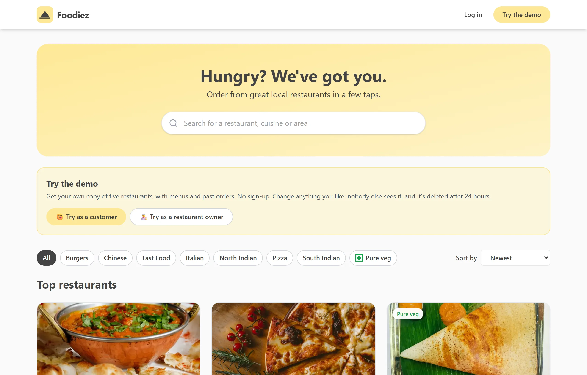
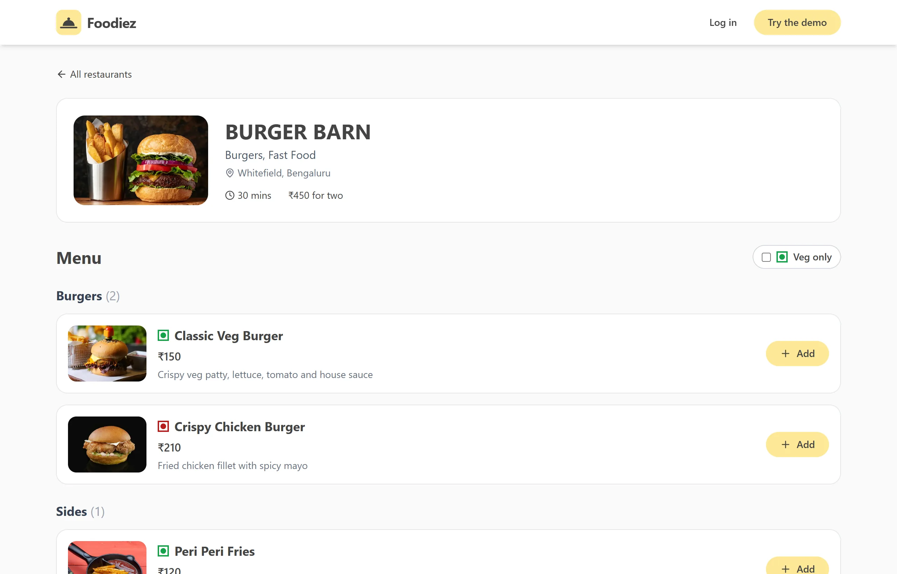
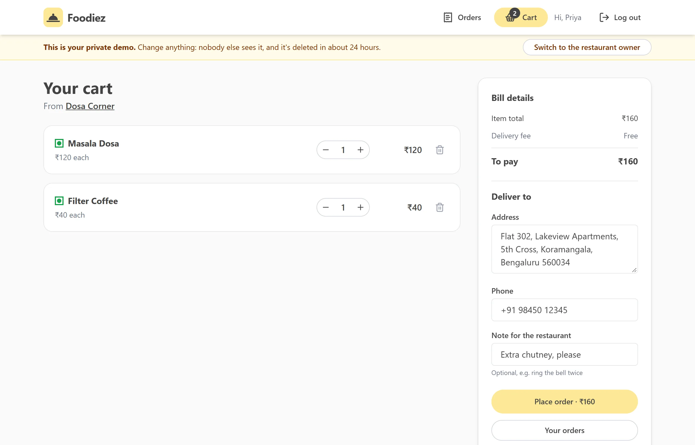
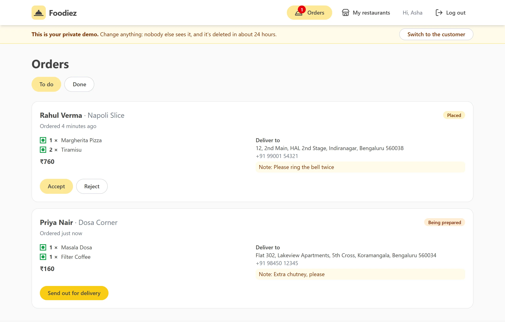
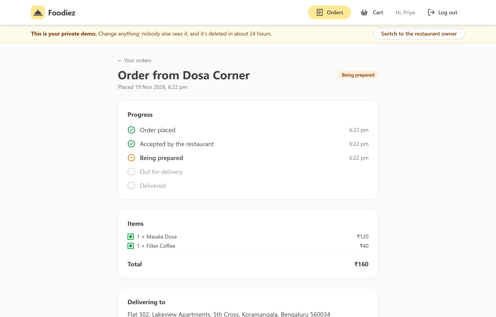
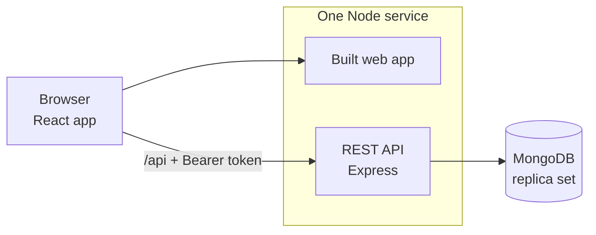
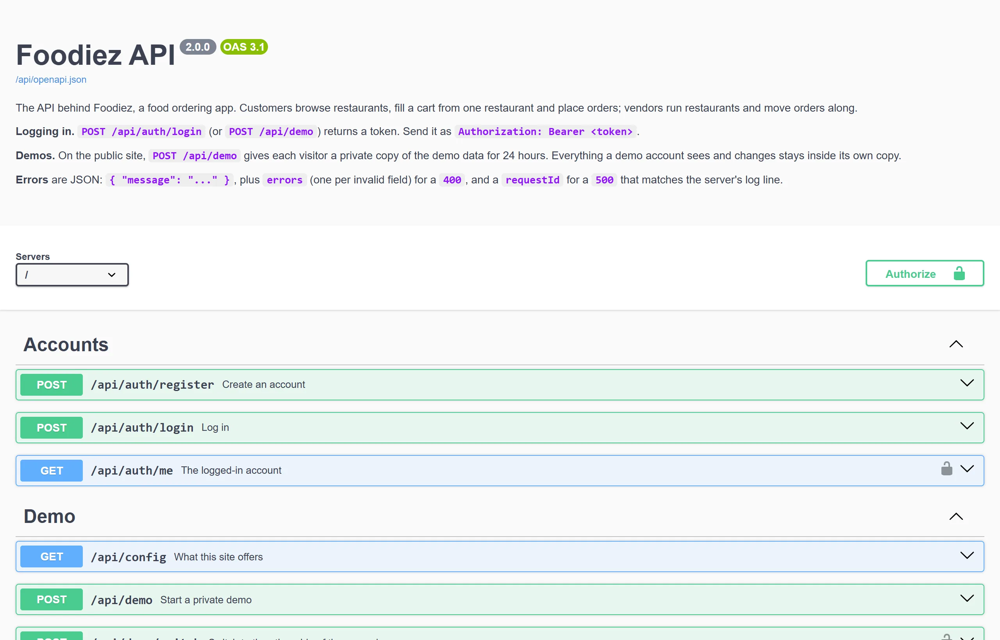

# Foodiez

[](https://github.com/iamrs77/foodiez/actions/workflows/ci.yml)

A food ordering web app. Customers browse restaurants, fill a cart, place orders and track them to their door. Restaurant owners (vendors) run their menus and move each order from "accepted" to "delivered".



## About

Foodiez is a full-stack JavaScript app: a React web app and an Express API on MongoDB.

- **Find food** without logging in: search by name, cuisine or area, filter by cuisine or pure veg, and sort by delivery time or price.
- **Read menus** in the restaurant's own sections, with photos, a veg-only toggle and dishes marked sold out.
- **Order** from one restaurant at a time, like real delivery apps, with a delivery address and a note for the kitchen, then **track** the order as the restaurant accepts, prepares and sends it.
- **Run restaurants** as a vendor: manage menus and photos, mark dishes sold out in one click, and handle incoming orders, which appear by themselves.
- **Try the demo** without signing up: every visitor gets a private copy of the restaurants, menus and orders for 24 hours, and can switch between the customer and the restaurant owner to see both sides of an order.

| Menu, in sections                                        | Checkout                                           |
| -------------------------------------------------------- | -------------------------------------------------- |
|  |  |

| The restaurant's orders                                             | Tracking an order                                         |
| ------------------------------------------------------------------- | --------------------------------------------------------- |
|  |  |

## How it works



- **Orders can't be placed twice.** Checkout creates the order and empties the cart in one MongoDB transaction, so two tabs ordering the same cart get one order, and an `Idempotency-Key` makes a retried request return the first order. A test fires three checkouts at once and expects exactly one.
- **Order updates can't collide.** Each status change is compare-and-set: if the restaurant accepts at the moment the customer cancels, exactly one wins.
- **The API enforces every rule.** Two roles, customer and vendor, with no admin to escalate to. Vendors can only change their own restaurants and orders, customers only their own cart and orders, and every request body goes through a zod schema that drops unknown fields.
- **Search uses an index.** Each restaurant keeps the words of its name, cuisine and area, and a search matches the start of those words, which MongoDB answers from an index instead of reading every restaurant.
- **Each demo visitor gets a private sandbox.** Every document has a `sandbox` field, the API scopes every query to the visitor's sandbox, and a MongoDB TTL index deletes the whole demo after 24 hours, with no clean-up job.
- **The API is documented and held to it.** An OpenAPI 3.1 spec, browsable at `/api/docs`, is checked against real responses by a contract test.
- **Tested end to end.** 88 API tests against a real in-memory MongoDB, 44 web app tests, and 5 Playwright browser tests that run the app the way the public demo runs it.
- **Free to host.** The API also serves the built web app, so it's one free Render service with a free MongoDB Atlas cluster.

The design, with diagrams, the data model, failure modes and the reasons behind each decision, is in the [documentation](#documentation).

## Tech stack

| Part     | Tools                                                                   | Why |
| -------- | ----------------------------------------------------------------------- | --- |
| Web app  | React 19, Vite, React Router, Redux Toolkit (RTK Query), Tailwind CSS 4 | The 2021 app's React, Redux and Tailwind, brought up to date. RTK Query caches server data and refreshes it by tag. |
| API      | Node.js, Express 5, Mongoose, zod, JWT, bcrypt, helmet, pino            | Express 5 sends async errors to one handler, zod checks every request body, and pino logs each request with an id. |
| Database | MongoDB                                                                 | Menus and orders are read whole, transactions keep checkout safe, it runs in memory for development and tests, and TTL indexes clean up demos. |
| Tests    | Vitest, Testing Library, supertest, mongodb-memory-server, Playwright, Ajv | Real HTTP requests against a real database, a real browser for whole journeys, and responses checked against the API spec. |
| Docs     | OpenAPI 3.1, Swagger UI                                                 | The API described in one file, readable and tryable at `/api/docs`. |
| DevOps   | Docker Compose, nginx, GitHub Actions, Render, MongoDB Atlas            | CI checks everything on each push, and the demo runs on free plans. |

What each choice replaced or was up against: [ADR 0008](docs/adr/0008-tech-stack.md).

## Run it locally

You need **[Node.js](https://nodejs.org) 22 or newer** (check with `node -v`) and **Git**. You don't need to install MongoDB or Docker.

```bash
git clone https://github.com/iamrs77/foodiez.git
cd foodiez
npm install
npm run dev
```

When the terminal shows `Local: http://localhost:5173/`, open that address and log in with one of the demo accounts below, or press **Try the demo**. (If port 5173 is busy, the web app picks the next free port and shows that one instead.)

- `npm install` installs everything for the API and the web app.
- `npm run dev` starts the API with its own temporary MongoDB and demo data, then starts the web app.
- The first start downloads MongoDB (about 75 MB, once), so it can take a minute or two.
- Press `Ctrl+C` to stop. The data is reset every time you start again.

### Demo accounts

Every demo account uses the password `password123`. The login page has buttons that fill them in for you.

| Account                 | What you can do                                                                                   |
| ----------------------- | ------------------------------------------------------------------------------------------------- |
| `customer@foodiez.dev`  | Order food. Already has two delivered orders.                                                     |
| `customer2@foodiez.dev` | Has a new order at Napoli Slice, waiting for the restaurant.                                      |
| `vendor@foodiez.dev`    | Owns Spice Route, Napoli Slice and Dosa Corner: change their menus, and accept and move orders.   |
| `vendor2@foodiez.dev`   | Owns Wok Express and Burger Barn.                                                                 |

You can also create your own customer or vendor account on the sign-up page. On the public site, these shared accounts and sign-ups are turned off, and visitors use **Try the demo** instead.

### With Docker

If you have [Docker](https://docs.docker.com/get-docker/), this runs MongoDB (as a one-member replica set, like Atlas), the API, and nginx serving the web app, like a production setup with a separate web server.

```bash
docker compose up --build
```

Open **http://localhost:8080**. The demo data is added the first time the database starts, and your data stays between restarts. Press `Ctrl+C` to stop. Run `docker compose down` to remove the containers, and add `--volumes` to delete the data too.

If you put this online, set your own secret first, for example `JWT_SECRET=some-long-random-text docker compose up --build`.

### With your own MongoDB

Use this when you work on the API and want to keep your data. Start MongoDB with `docker compose up -d db`, install it yourself, or use a free [MongoDB Atlas](https://www.mongodb.com/atlas) database. Then:

```bash
cd backend
cp .env.example .env    # Windows PowerShell: copy .env.example .env
npm run dev             # the API, restarts when you change code
```

Change `MONGODB_URI` in `backend/.env` if your database isn't at `mongodb://localhost:27017`. In a second terminal, start the web app with `cd frontend` and `npm run dev`. To reset the database to the demo data, run `npm run seed` in `backend`.

Orders are placed in a transaction, which needs a replica set. Atlas and the Docker database are replica sets. A MongoDB you installed yourself usually isn't: the app still works, placing orders without a transaction, and logs a warning.

### Deploy it for free

The public demo runs on a free Render web service and a free MongoDB Atlas cluster. [docs/deploy.md](docs/deploy.md) has the steps, and `render.yaml` has the settings.

### Settings

The API reads these from `backend/.env` or from environment variables. The quick start and Docker set them for you.

| Name                  | What it is                                                         | Default                 |
| --------------------- | ------------------------------------------------------------------ | ----------------------- |
| `MONGODB_URI`         | Where MongoDB is (required)                                        |                         |
| `JWT_SECRET`          | Secret for signing login tokens, at least 16 characters (required) |                         |
| `JWT_EXPIRES_IN`      | How long a login lasts                                             | `1d`                    |
| `PORT`                | Port for the API                                                   | `4000`                  |
| `CORS_ORIGIN`         | Web app addresses allowed to call the API, comma separated         | `http://localhost:5173` |
| `TRUST_PROXY`         | Number of proxies in front of the API (`1` behind nginx)           | `0`                     |
| `LOG_LEVEL`           | How much the API logs: `fatal` to `trace`, or `silent`             | `info`                  |
| `SEED_DEMO_DATA`      | Add the demo data when the database is empty                       | `false`                 |
| `DEMO_ACCOUNTS_LOGIN` | Let people log in to the demo accounts with the shared password    | `true`                  |
| `SIGNUPS_ENABLED`     | Let visitors create their own accounts                             | `true`                  |
| `DEMO_ENABLED`        | Offer **Try the demo**                                             | `true`                  |
| `DEMO_TTL_HOURS`      | How long a visitor's demo lasts                                    | `24`                    |
| `DEMO_MAX_ACTIVE`     | Most demos at once                                                 | `200`                   |
| `DEMO_RATE_LIMIT`     | New demos per IP address per hour                                  | `10`                    |
| `WEB_APP_DIR`         | Folder of the built web app; when set, the API serves it too       | not set                 |

If a required setting is missing, the API stops at startup and says which one.

### Troubleshooting

| What you see                                                | What to do                                                                                                                                                      |
| ----------------------------------------------------------- | --------------------------------------------------------------------------------------------------------------------------------------------------------------- |
| `npm install` fails with `Unsupported engine`               | Your Node.js is too old. Install version 22 or newer from [nodejs.org](https://nodejs.org).                                                                     |
| `Port 4000 is already in use`                               | Another program (often an earlier run that didn't stop) uses port 4000. Close it and run `npm run dev` again.                                                   |
| The first `npm run dev` stops while downloading MongoDB     | Check your internet connection and try again. Behind a strict company network, use [Docker](#with-docker) or [your own MongoDB](#with-your-own-mongodb) instead. |
| The page says "Can't reach the server. Is the API running?" | The API isn't running or has stopped. Look at the `[api]` lines in the terminal for the reason.                                                                 |
| You want to start from the demo data again                  | With the quick start, stop and run `npm run dev` again. With your own MongoDB, run `npm run seed` in `backend`.                                                 |

## Tests

```bash
npm test      # API tests, then web app tests
npm run e2e   # browser tests: builds the app and runs it like the public demo
```

You can also run `npm test` inside `backend` or `frontend` on its own. The API tests start their own in-memory MongoDB, so they need no setup. The browser tests download a browser the first time (`npx playwright install chromium`), or use your own Chrome with `PLAYWRIGHT_CHANNEL=chrome npm run e2e`.

- **API tests** send real HTTP requests to the app. They check, for example, that a vendor can't change another vendor's restaurant or orders, that nobody can sign up as an admin, that old orders keep the price that was paid, that three checkouts of one cart at once place one order, that an order can't be both accepted and cancelled, that search is answered from an index, and that two demo visitors never see each other's changes.
- **A contract test** checks the API against its OpenAPI spec: every documented route exists, and real responses match the documented schemas exactly.
- **Web app tests** render the real pages with a fake network. They cover logging in, the one-restaurant cart rule, checkout and its retries, tracking and cancelling, the restaurant's orders, menus, filters, demos and the error messages.
- **Browser tests** (Playwright) click through whole journeys in a real browser: ordering as a customer and accepting the order as the restaurant, menu changes staying inside one demo, and finding food. Each fails on any error in the browser's console.

GitHub Actions runs all of them on every push, along with lint, format checks and the build, and starts the Docker setup and places an order through it.

## API

The full description is in [`backend/src/openapi.yaml`](backend/src/openapi.yaml), and the running API serves it with Swagger UI at **`/api/docs`**, where you can try each endpoint.



| Method | Path                            | Who       | What it does                                                                  |
| ------ | ------------------------------- | --------- | ----------------------------------------------------------------------------- |
| POST   | `/api/auth/register`            | anyone    | Create an account                                                             |
| POST   | `/api/auth/login`               | anyone    | Log in, returns a token                                                       |
| GET    | `/api/auth/me`                  | logged in | Your account                                                                  |
| GET    | `/api/restaurants`              | anyone    | List restaurants: `?search=`, `cuisine=`, `veg=true`, `sort=fastest\|cheapest` |
| GET    | `/api/restaurants/cuisines`     | anyone    | The cuisines to filter by                                                     |
| GET    | `/api/restaurants/:id`          | anyone    | One restaurant                                                                |
| GET    | `/api/restaurants/:id/dishes`   | anyone    | A restaurant's menu                                                           |
| GET    | `/api/restaurants/mine`         | vendor    | Your restaurants                                                              |
| POST   | `/api/restaurants`              | vendor    | Add a restaurant                                                              |
| PATCH  | `/api/restaurants/:id`          | owner     | Change a restaurant                                                           |
| DELETE | `/api/restaurants/:id`          | owner     | Delete a restaurant and its menu                                              |
| POST   | `/api/restaurants/:id/dishes`   | owner     | Add a dish                                                                    |
| PATCH  | `/api/dishes/:id`               | owner     | Change a dish, e.g. mark it sold out                                          |
| DELETE | `/api/dishes/:id`               | owner     | Delete a dish                                                                 |
| GET    | `/api/cart`                     | customer  | Your cart with the total                                                      |
| POST   | `/api/cart/items`               | customer  | Add a dish (or raise its quantity)                                            |
| PATCH  | `/api/cart/items/:id`           | customer  | Change a quantity                                                             |
| DELETE | `/api/cart/items/:id`           | customer  | Remove a dish                                                                 |
| DELETE | `/api/cart`                     | customer  | Empty the cart                                                                |
| POST   | `/api/orders`                   | customer  | Order the cart, with `{ delivery }` and an optional `Idempotency-Key` header  |
| GET    | `/api/orders`                   | customer  | Your orders, newest first                                                     |
| GET    | `/api/orders/:id`               | customer  | One order, to track it                                                        |
| POST   | `/api/orders/:id/cancel`        | customer  | Cancel an order the restaurant hasn't accepted                                |
| GET    | `/api/vendor/orders`            | vendor    | Orders for your restaurants: `?view=active` or `past`                         |
| PATCH  | `/api/vendor/orders/:id`        | vendor    | Move an order to its next step, with `{ status }`                             |
| GET    | `/api/config`                   | anyone    | What this site offers (sign-ups, the demo)                                    |
| POST   | `/api/demo`                     | anyone    | Start a private demo as `{ "as": "customer" }` or `"vendor"`, returns a token |
| POST   | `/api/demo/switch`              | demo      | Log in as the other side of the same demo                                     |
| GET    | `/api/health`                   | anyone    | Whether the API and database are up                                           |

The API runs on http://localhost:4000. Send the token as `Authorization: Bearer <token>`. Errors look like `{ "message": "...", "errors": [{ "field": "...", "message": "..." }] }`, and a `500` includes a `requestId` that matches the server's log line.

## Project structure

The API and the web app live side by side, each with its own `package.json`. The root `package.json` runs commands in both ([ADR 0001](docs/adr/0001-one-repository.md)).

```
package.json              npm install / dev / test / e2e / build / start for the whole project
backend/                  The REST API
  src/
    server.js             Connects to MongoDB, adds the demo data if empty, starts the API
    app.js                Middleware and routes, and serving the built web app when WEB_APP_DIR is set
    config.js             Reads and checks the settings (environment variables)
    db.js                 The database connection, and running work in a transaction
    logger.js             Request logging with request ids (pino)
    openapi.yaml          The API's description; docs.js serves it with Swagger UI
    routes/               URLs, with the login and role each one needs
    controllers/          What each endpoint does: auth, restaurants, dishes, cart, orders, demo
    middleware/           Login (requireAuth, optionalAuth, requireRole), validation, errors
    models/               Mongoose schemas, and the sandbox fields every collection shares
    seed/                 Demo data, loaded as the showcase or as a visitor's sandbox
  scripts/dev-memory.js   Runs the API with a temporary in-memory MongoDB
  test/                   API and contract tests, against an in-memory MongoDB
frontend/                 The React web app
  public/images/          The demo's restaurant and dish photos
  src/
    app/                  Redux store and every API call (RTK Query)
    features/auth/        The logged-in user, kept across reloads
    pages/                One file per page; vendor pages in pages/vendor
    components/           Navbar, cards, form fields, the demo card and banner, the error boundary
    lib/                  Formatting, error messages, order statuses, site settings, small hooks
  nginx.conf              Serves the app and passes /api to the API in Docker
e2e/                      Browser tests (Playwright); playwright.config.js starts the app for them
docs/
  architecture.md         How it works: diagrams, data model, flows, security, failure modes
  deploy.md               Deploying for free on Render and MongoDB Atlas
  adr/                    Decision records: why each big choice was made, and what it costs
  photo-credits.md        Who took the demo's photos
docker-compose.yml        MongoDB (a replica set) + API + web app with nginx
render.yaml               The free deployment on Render
```

## Documentation

- [Architecture](docs/architecture.md): the system, the data model, the main flows, security, failure modes, limits and logging
- [Deployment](docs/deploy.md): deploying for free on Render and MongoDB Atlas
- [API reference](backend/src/openapi.yaml): OpenAPI 3.1, also served at `/api/docs`
- Decision records:
  1. [One repository for the API and the web app](docs/adr/0001-one-repository.md)
  2. [Keep MongoDB, with Mongoose](docs/adr/0002-mongodb.md)
  3. [Logins with signed tokens (JWT)](docs/adr/0003-jwt-logins.md)
  4. [Two roles, ownership checked on every change, and no admin](docs/adr/0004-roles-and-ownership.md)
  5. [One restaurant per cart, and orders that keep a copy of what was ordered](docs/adr/0005-cart-and-orders.md)
  6. [A private sandbox per demo visitor, deleted by TTL indexes](docs/adr/0006-demo-sandboxes.md)
  7. [One free service on Render, with MongoDB Atlas](docs/adr/0007-one-free-service.md)
  8. [The tech stack, and what each choice replaced](docs/adr/0008-tech-stack.md)
  9. [An order lifecycle, and placing orders safely](docs/adr/0009-order-lifecycle-and-safe-checkout.md)
  10. [Search that uses an index: matching the start of words](docs/adr/0010-indexed-search.md)
- [Photo credits](docs/photo-credits.md)

## History

I first built Foodiez in 2021 as five separate repos: an Express API, and the same React app four times (plain CSS, Material-UI, Tailwind and AWS Amplify). In 2026 I merged the API and the Tailwind app into this repo and rebuilt them. The rebuild fixed security problems (anyone could sign up as an admin, and any vendor could edit any restaurant), replaced the crash-prone request handling, added a real order model, tests, Docker and CI, and moved the web app from Create React App to Vite. Later that year it got private demo sandboxes and free hosting, then orders that restaurants handle and customers track, safe checkout, photos, menu sections, filters, indexed search, browser tests and an OpenAPI spec. The original 2021 commits are still in the history.

## Ideas for later

- Online payments
- Live order updates with server-sent events, instead of checking every 5 seconds
- Photo uploads (photos are links for now)
- Ratings and reviews
- Pages (pagination) for long restaurant lists, and typo-tolerant search with Atlas Search
