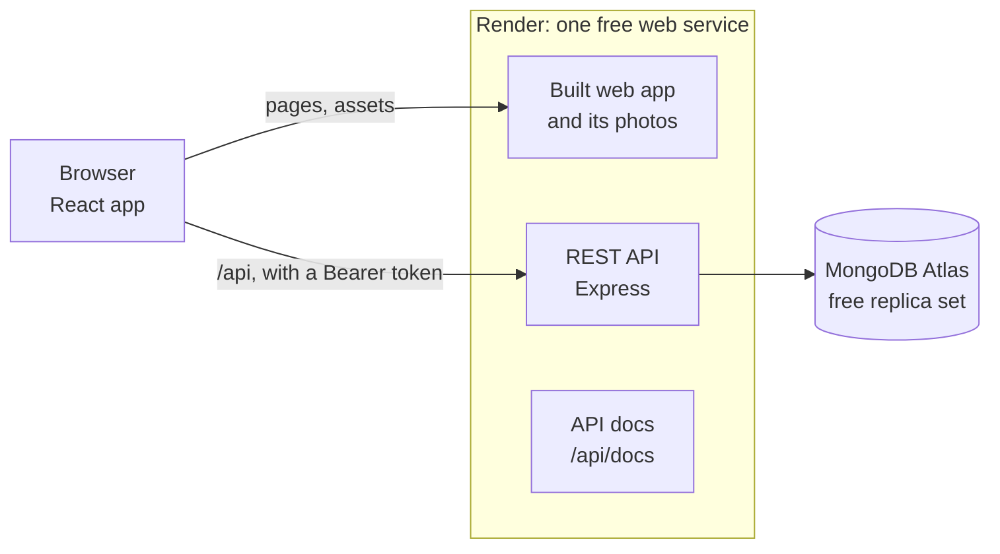
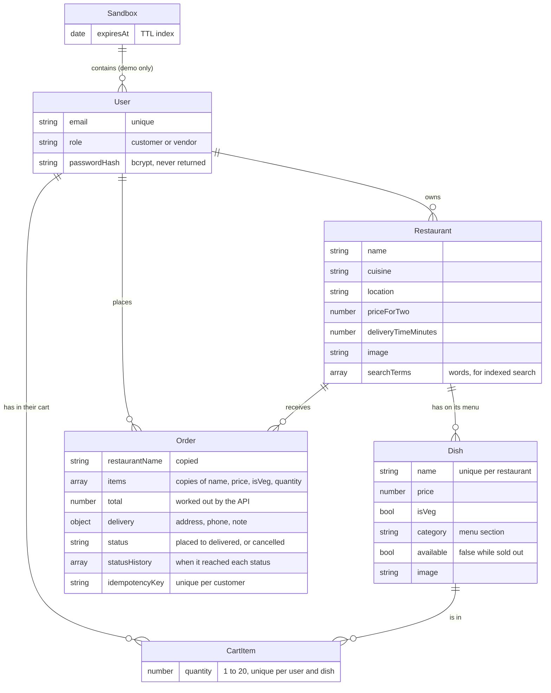
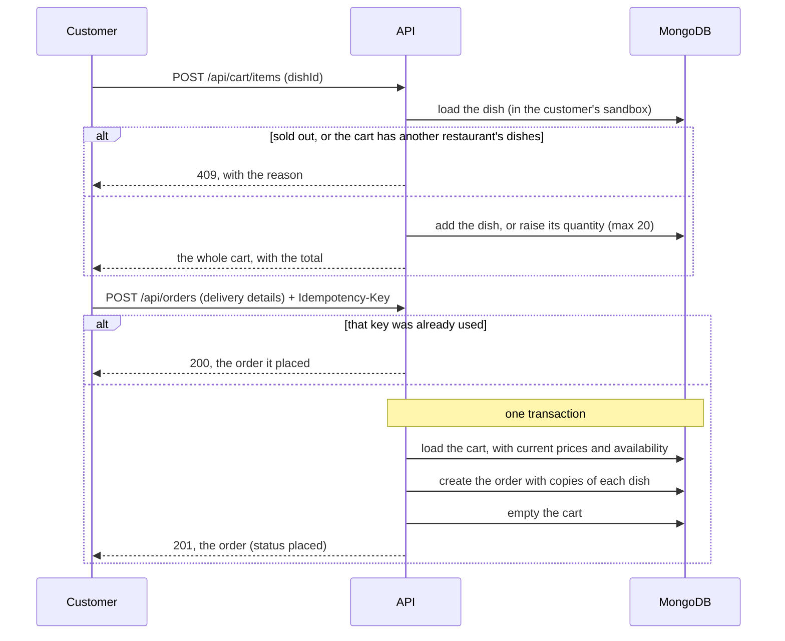
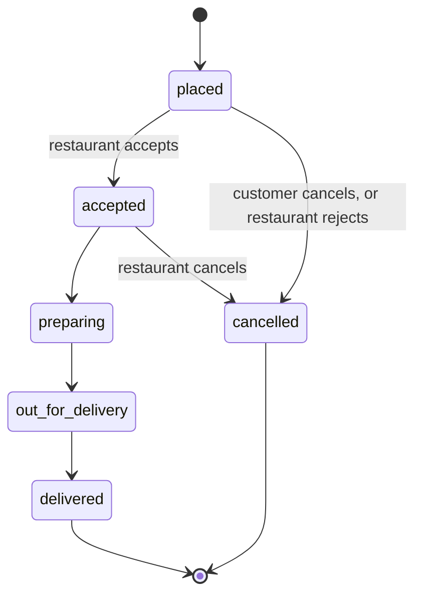
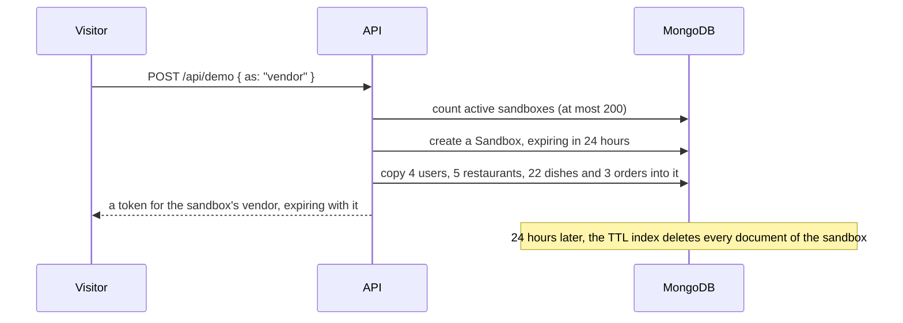

# Architecture

Foodiez is a small app, so the design aims to be simple and correct rather than clever: one API, one database, and a web app that talks only to the API. This document explains how the pieces fit, how the main flows work, what can go wrong, and where the limits are. The reasons behind each decision are in the [decision records](adr).

## Constraints

- **It runs for free**: one small Render web service that sleeps when idle, and a free MongoDB Atlas cluster with 512 MB of storage ([ADR 0007](adr/0007-one-free-service.md)).
- **Strangers use the public demo**, so no visitor may be able to change what other visitors see ([ADR 0006](adr/0006-demo-sandboxes.md)).
- **Anyone can run it locally with Node.js alone**: no database install and no Docker ([ADR 0002](adr/0002-mongodb.md)).

## System overview

On the public site, one Node service runs the API and also serves the built web app:



Locally, `npm run dev` runs the API with a temporary in-memory MongoDB (a one-member replica set, like Atlas), and Vite serves the web app and passes `/api` on to the API. With Docker Compose, nginx serves the web app and passes `/api` to the API container. The code is the same in all three; only `WEB_APP_DIR` decides whether the API serves the web app itself.

### Code layout

```
backend/src/
  routes/         URL → middleware → controller, one file per area
  middleware/     login (requireAuth, optionalAuth, requireRole), validation, errors
  controllers/    what each endpoint does
  models/         Mongoose schemas, the sandbox plugin
  seed/           demo data, and loading it as the showcase or a visitor's sandbox
  db.js           the connection, and inTransaction()
  logger.js       request logging (pino) with request ids
  openapi.yaml    the API's description; docs.js serves it with Swagger UI
frontend/src/
  app/api.js      every API call (RTK Query), with its cache tags
  features/auth/  the logged-in user, kept in localStorage
  pages/          one file per page; vendor pages in pages/vendor
  components/     navbar, cards, the demo card and banner, the error boundary
  lib/            formatting, order statuses, site settings
frontend/public/images/   the demo's restaurant and dish photos
e2e/              browser tests (Playwright)
```

A request goes through the same steps everywhere: pino logs it with a request id, the route checks the login and role, `validateBody` parses the body with a zod schema (unknown fields are dropped), and the controller does the work. Errors from anywhere end up in one error handler that turns them into `{ message, errors?, requestId? }` JSON.

## Data model



- **Orders are snapshots.** An order copies each dish's name and price, the restaurant's name, the customer's name and the delivery details at the time it's placed. Changing or deleting a dish later doesn't change order history ([ADR 0005](adr/0005-cart-and-orders.md)).
- **The cart is one document per dish**, with a unique index on (user, dish). Adding a dish that's already there raises its quantity.
- **There are no foreign keys**, so deletes cascade in code: deleting a restaurant deletes its dishes and removes them from every cart.
- **Every collection has `sandbox` and `expiresAt` fields** for the demo; see [Demo sandboxes](#demo-sandboxes).
- **Pure veg** isn't stored: the list works it out from the dishes (a restaurant with dishes, none of them non-veg).

Indexes: `users.email` (unique), `restaurants.owner`, `restaurants (sandbox, createdAt, _id)` for the list, `restaurants (sandbox, searchTerms)` for search, `dishes (restaurant, name)` (unique), `cartitems (user, dish)` (unique), `orders.user`, `orders (restaurant, status, createdAt)` for a restaurant's orders, `orders (user, idempotencyKey)` (unique, when a key was sent), and a TTL index on `expiresAt` in every collection.

## Key flows

### Logging in

1. The login is rate-limited to 20 tries per 15 minutes per IP.
2. The API looks up the email and checks the password with bcrypt. An unknown email is checked against a dummy hash, so it takes as long as a wrong password and gets the same error: nobody can find out which emails have accounts.
3. The API returns a JWT (signed with `JWT_SECRET`, valid for a day) and the user. The web app keeps both in `localStorage` and sends `Authorization: Bearer <token>` on every request.
4. On each request, `requireAuth` checks the token and loads the user again, so a deleted account stops working straight away ([ADR 0003](adr/0003-jwt-logins.md)).

When any request gets a `401` while the web app thinks it's logged in, the web app logs out and clears its cache.

### Finding food

The restaurant list takes a search, a cuisine, a pure-veg filter and a sort (newest, fastest delivery, lowest price), all kept in the web app's URL. **Search uses an index** ([ADR 0010](adr/0010-indexed-search.md)): each restaurant keeps the lower-case words of its name, cuisine and area, and every typed word must be the start of one of them, which MongoDB answers from the `(sandbox, searchTerms)` index. A menu is grouped by the restaurant's own sections (`category`), with a veg-only toggle; sold out dishes stay on it but can't be added.

### Ordering



- **Placing an order is one transaction** ([ADR 0009](adr/0009-order-lifecycle-and-safe-checkout.md)): the order is created and the cart emptied together. If two checkouts of one cart run at once, the second one's writes conflict; MongoDB retries it, and it finds the cart empty. A retried request with the same `Idempotency-Key` gets the first order back.
- Every cart endpoint answers with the whole cart, and the web app puts it straight into its cache, so the navbar's count and the cart page update without another request.
- Prices and the total always come from the database, never from the browser. A dish that sold out while in the cart stops the order with a `409` naming it.

### An order's journey



The restaurant moves an order along from its Orders page; the customer watches it on the tracking page. Both pages refresh every 5 seconds while the order is open. **Each change is compare-and-set**: it applies only if the order is still in the status that was read, so a restaurant accepting while the customer cancels, or a double click, can't both win: one gets a `409`.

### Vendors changing restaurants and menus

Every change to a restaurant or dish loads it first and checks that the logged-in vendor owns it (for a dish, through its restaurant). Another vendor gets a `403`, so the API enforces ownership, not just the web app ([ADR 0004](adr/0004-roles-and-ownership.md)). Vendors can mark a dish sold out and back in stock from the menu, in one click.

### Demo sandboxes

Each visitor who presses **Try the demo** gets a private copy of the demo data ([ADR 0006](adr/0006-demo-sandboxes.md)):



- **Scoping.** The sandbox comes from the logged-in user, never from the request. Pages anyone can see use `optionalAuth`: a visitor in a demo sees their sandbox's restaurants, everyone else sees the showcase (`sandbox: null`). New restaurants, dishes, cart items and orders take the sandbox and expiry of the user (or restaurant) they belong to.
- **Isolation.** A restaurant, dish or order from another sandbox is "not found" (`404`). Editing one fails the ownership check (`403`). A demo customer can't add a dish from another sandbox to their cart.
- **Something to do straight away.** The demo customer has two delivered orders, and the demo's restaurant owner has a new order from another customer waiting to be accepted.
- **Switching sides.** `POST /api/demo/switch` gives a token for the other side of the same sandbox (customer ↔ restaurant owner), so a visitor can order as the customer, accept it as the owner, and watch it move on the tracking page.
- **Expiry.** MongoDB's TTL monitor deletes expired documents about once a minute. Until it does, `requireAuth` refuses any user whose `expiresAt` has passed, and the token expires at the same moment anyway.
- **The showcase stays fixed.** On the public site, `DEMO_ACCOUNTS_LOGIN=false` refuses logins to the shared showcase accounts and `SIGNUPS_ENABLED=false` turns off sign-ups, so nobody can change the restaurants that logged-out visitors browse.

## Security

| Area | How |
|---|---|
| Roles | Two roles, customer and vendor, chosen at sign-up. There's no admin role, so nobody can sign up as one or escalate to one. Each endpoint checks the role. |
| Ownership | Vendors can only change their own restaurants, dishes and orders; customers can only see and change their own cart and orders. Every query filters by the logged-in user. Tests try each of these with a second account. |
| Passwords | bcrypt (cost 10), at most 72 bytes (bcrypt ignores the rest), never returned by the API (`select: false` and hidden from JSON). |
| Logins | Signed JWTs that expire after a day; the user is loaded again on every request. Login is rate-limited and doesn't reveal which emails exist. Tokens are redacted from the logs. |
| Input | Every request body is parsed by a zod schema, which drops unknown fields, so a client can't set `owner`, `role`, `total` or an order's `status`. Ids are checked before any query. `strictQuery` is on, search words are escaped before they go into a regular expression, and an unknown sort is ignored. |
| Photos | A photo is one of the app's own demo photos or an `https://` link; anything else is refused. |
| Headers and CORS | Helmet sets security headers, including a content security policy that allows the app's own scripts and https images, and no inline scripts (Swagger UI's start-up script is served as a file). CORS only allows `CORS_ORIGIN`; on the public site the web app and API share one origin. JSON bodies are capped at 100 KB. |
| Errors | A `500` says only "Something went wrong" and a request id; the details go to the log line with the same id. |
| Demo | Rate-limited to 10 new demos per IP per hour and 200 at once. Demo accounts can't log in with a password, and their data is invisible outside their sandbox. |

## Failure modes

| What happens | What the app does |
|---|---|
| The database is unreachable at start-up | The API stops with "Could not connect to MongoDB" and the reason, after 10 seconds. |
| The database goes away while running | Requests wait up to 10 seconds (Mongoose buffers them), then fail with a `500` and a request id. `/api/health` answers `503`, so Render sees it's unhealthy. |
| The same cart is ordered twice at once (two tabs, or two devices) | Checkout is one transaction: the second finds the cart already empty and gets "Your cart is empty". A test sends three at once and gets one order. |
| A checkout request is retried after a timeout | The retry carries the same `Idempotency-Key` and gets the first order back, so it isn't placed twice. |
| The API crashes partway through placing an order | The transaction never commits: no order, and the cart is unchanged. |
| The restaurant accepts at the moment the customer cancels | The changes are compare-and-set: one wins, the other gets a `409` and the page shows the order's real status. |
| A dish sells out while it's in someone's cart | The cart shows it as sold out, and checkout is refused with a `409` naming it until it's removed. |
| A vendor deletes a dish that's in someone's cart | The dish is removed from the cart the next time it's read. Past orders keep their copy. |
| A vendor deletes a restaurant | Its dishes are deleted and removed from every cart. Orders keep the restaurant's name. |
| Two requests add the same new dish to one cart at the same moment | The unique index on (user, dish) lets one through. The other gets a `409`; trying again raises the quantity. |
| Two requests add dishes from two restaurants at the same moment | Both can pass the one-restaurant check, leaving a mixed cart. Rare, since the web app checks first and a person adds one dish at a time. |
| The database is a single `mongod`, not a replica set | The API logs a warning and places orders without a transaction; two simultaneous checkouts of one cart could then both succeed. Atlas, Docker and the in-memory database are all replica sets. |
| A page crashes in the browser | The error boundary shows "Something went wrong on this page" with a reload button; the navbar still works, and going to another page clears it. |
| A visitor's demo expires while they're using it | The next request gets a `401` "Your demo has ended", the web app logs out, and the visitor is back on the showcase. |
| 200 demos are active | `POST /api/demo` answers `503` "The demo is very popular right now". |
| The free Render service is asleep | The first visit waits about a minute while it starts. Nothing is lost. |
| The free Atlas cluster was paused after weeks without connections | `/api/health` answers `503` until it's resumed from the Atlas dashboard. |

## Capacity and limits

- **Storage.** A demo is about 35 small documents; with at most 200 active, demos use a few megabytes of the 512 MB free cluster, and TTL indexes keep it flat. The photos are part of the web app (617 KB), not the database.
- **Search scales; lists don't page yet.** Search is served from an index, but the restaurant list returns every match. That's fine for hundreds of restaurants; beyond that it needs pages. Order history returns the latest 50, and a restaurant's done orders the latest 50.
- **Polling.** An open Orders or tracking page asks for updates every 5 seconds, and stops when the tab is hidden or the order is finished. Server-sent events would replace it if many pages stayed open all day.
- **One instance.** Login and demo rate limits are counted in memory, which is right for one instance. With several, they'd need a shared store such as Redis.
- **Free-plan throughput.** The free Atlas cluster allows about 100 operations a second. A page view uses one or two; starting a demo uses about 20.

## Observability

- **Logs.** pino writes one line per request: method, path, status and time, with a request id. In production it's JSON for log search; in development, readable lines. Login tokens are never logged, and health checks are skipped. `LOG_LEVEL` sets how much is logged.
- **Request ids.** Every response has an `X-Request-Id` header (a client can send its own), and a `500` response includes it, so a reported error can be found in the logs.
- **Health.** `/api/health` answers `200` when the database is connected and `503` when it isn't; Render uses it to decide whether a deploy is healthy.

## Testing

- **API tests** (Vitest and supertest) send real HTTP requests to the real app, backed by a real MongoDB that `mongodb-memory-server` runs in memory as a one-member replica set. They cover each role and ownership rule with a second account, the cart and order rules, the order lifecycle and its races (three checkouts at once, accept against cancel), sold out dishes, search (including that it's an index scan), and the demo sandboxes: isolation between two visitors, expiry, switching sides and the public-site settings. The TTL monitor is turned off in tests, so a test can backdate a demo without MongoDB deleting it halfway through.
- **A contract test** checks the API against its OpenAPI spec: every documented operation must reach a real route, and real customer, vendor and error responses must match the documented schema for their status exactly.
- **Web app tests** (Vitest and Testing Library) render the whole app at a URL with a fake `fetch`, and click through it like a person would: logging in, the cart rule, checkout and its retries, tracking and cancelling, the restaurant's orders, menus and filters, starting and switching demos.
- **Browser tests** (Playwright) run the built app the way the public demo runs it, in a real browser: the showcase, ordering as a customer and accepting as the owner, menu changes staying inside one demo, filters and search. Each fails on any browser console error.
- **CI** (GitHub Actions) runs lint, format checks and all of these, builds the web app, and starts the whole Docker Compose setup and places an order through it.
